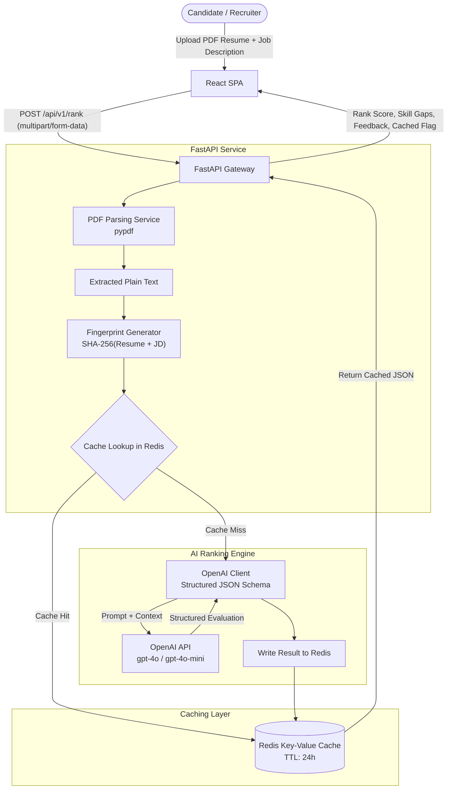
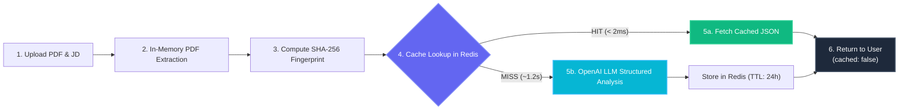

# AI-Powered Resume Ranker: System Architecture

## 1. System Overview

The **AI-Powered Resume Ranker** is an end-to-end intelligent screening system that parses PDF resumes, analyzes qualification alignment against a target Job Description (JD), and generates detailed scoring, skill gap identification, and recruiter/candidate feedback.

To optimize latency, cost, and API quotas, the system integrates a **SHA-256 fingerprinting cache layer with Redis**.

---

## 2. High-Level Architecture Diagram



---

## 3. Core Component Breakdown

### A. Frontend (React)
- **Dropzone & Input Form**: Drag-and-drop resume upload (`.pdf`) and Job Description text editor.
- **Dynamic Scoring Dashboard**:
  - Radial score progress gauge (0–100%).
  - Breakdown categories: Technical Skills, Experience Alignment, Education match.
- **Skill Comparison Grid**: Visual badges separating *Matched Skills* vs *Missing Skills / Skill Gaps*.
- **AI Recommendation Drawer**: Actionable bullet points on how the candidate can bridge gaps or highlight key experiences.
- **Cache Indicator**: Visual pill showing whether results were retrieved from cache in `<10ms` or processed live via OpenAI.

### B. Backend API (FastAPI)
- **Asynchronous Pipeline**: Fully async endpoints leveraging `asyncio`, `aiofiles`, and `redis-py` async client.
- **PDF Extraction Module**:
  - Python-native robust extraction (`pypdf` / `pdfplumber` / PyMuPDF) supporting clean text extraction, multi-column layouts, and graceful fallback.
- **Fingerprinting & Normalization**:
  - Text cleanup (stripping excess whitespace, lowercase normalization).
  - Composite SHA-256 hashing:
    $$\text{Fingerprint} = \text{SHA256}(\text{norm}(\text{resume\_text}) + "::" + \text{norm}(\text{job\_description}))$$
- **Redis Cache Layer**:
  - Key format: `resume_rank:{sha256_hash}`
  - Expiration: Configurable TTL (default: 86400s / 24 hours).
  - Hit response latency: `< 15ms`.
- **OpenAI Structured Analysis**:
  - Utilizes OpenAI JSON Mode / Pydantic Structured Outputs (`gpt-4o-mini` or `gpt-4o`).
  - Strict JSON schema ensuring consistent typing for scores, arrays, and descriptions.

---

## 4. Data Flow & Caching Strategy



### Execution Lifecycle Breakdown

| Step | Component | Operation | Typical Latency | Output |
|---|---|---|---|---|
| **1** | **Client (React)** | User drops `.pdf` resume + submits Job Description | — | `multipart/form-data` payload |
| **2** | **PDF Parser (`pypdf`)** | Reads PDF bytes in-memory (`io.BytesIO`), strips whitespace | ~5 ms – 15 ms | Clean plain-text string |
| **3** | **Fingerprinter** | Normalizes text and computes composite SHA-256 hash | < 1 ms | 64-char hexadecimal digest |
| **4** | **Redis Cache** | Queries key `resume_rank:<fingerprint>` | **< 1.5 ms** | JSON payload or `nil` |
| **5a (Hit)** | **Redis Storage** | Deserializes cached JSON directly to client | **< 2 ms total** | `cached: true` (Zero LLM cost) |
| **5b (Miss)** | **OpenAI (`gpt-4o-mini`)** | Evaluates fit, scores categories, identifies missing skills | ~1,100 ms – 1,800 ms | Strict Pydantic output schema |
| **5c** | **Redis Storage** | Stores newly computed result with 24h TTL (`SETEX`) | < 2 ms | Stored for instant repeat hits |
| **6** | **Client (React)** | Displays animated radial gauge, skill badges, and feedback | Instant | Rendered dashboard |

---

## 5. Structured Data Schema

### AI Evaluation Output (Pydantic & JSON Schema)
```json
{
  "match_score": 85,
  "summary": "Strong backend candidate with extensive Python & Docker experience; minor gaps in Kubernetes orchestration.",
  "category_scores": {
    "technical_skills": 88,
    "experience_alignment": 82,
    "education_and_certifications": 90
  },
  "matched_skills": [
    "Python",
    "FastAPI",
    "PostgreSQL",
    "Redis",
    "Docker"
  ],
  "missing_skills": [
    "Kubernetes",
    "CI/CD pipeline configuration",
    "AWS Lambda"
  ],
  "strengths": [
    "5+ years hands-on microservices development with FastAPI",
    "Demonstrated experience designing high-throughput caching systems"
  ],
  "weaknesses_and_gaps": [
    "Lacks documented cloud deployment experience (AWS/GCP)"
  ],
  "actionable_feedback": [
    "Highlight any AWS services utilized in past positions",
    "Add details on Kubernetes or container orchestration exposure"
  ]
}
```
